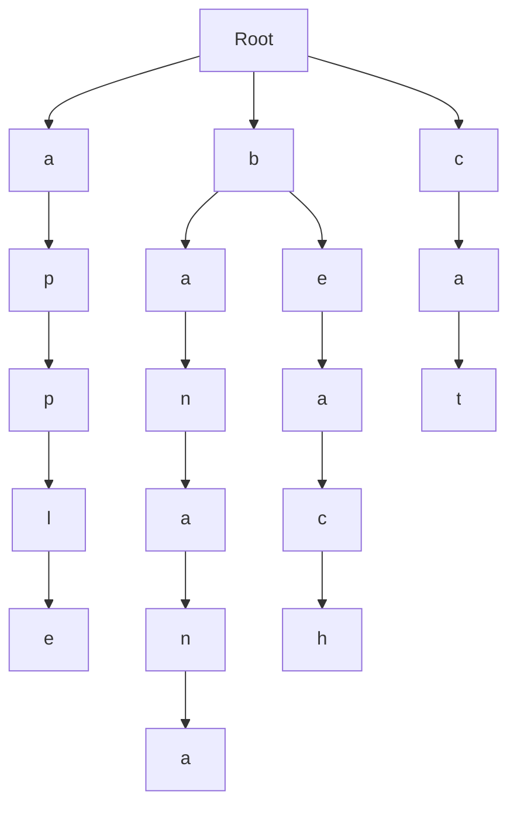

# Trie

If you want to compare many strings, checking them one by one using brute force is slow and wastes a lot of computational effort.

```cpp
"cat" != "apple"
"cat" != "banana"
"cat" != "beach"
"cat" == "cat"
```

Instead, we can organize them into a *trie*, which is a tree-based data structure used to compare strings efficently.



In a trie, if a character of the string doesn't match a node of corresponding depth, its children do not need to be searched, saving time compared to a brute force algorithm.

```cpp
"c" != "a" // Cat
"c" != "b" // Cat
"c" == "c" // Cat
"a" == "a" // cAt
"t" == "t" // caT
```

To add a string to the trie, we split the string up into individual characters. For every character, we check if a child node representing the given character exists. If it doesn't, we create it. Then, we advance to that node and repeat.

```python
current node = root node
for every character:
    if current node's children do not contain a node representing the character, create the node
    current node = child node
```

To check if a string is in the trie, we again split the string up into individual characters. However, for every character, if a child node representing the character is not found, we return early. If all of the corresponding nodes exist, we have found a match.

```python
current node = root node
for every character:
    if current node's children do not contain a node representing the character, return false (not found)
    current node = child node
return true (found)
```

The corresponding C++ code for this data structure is:

```cpp
#include <iostream>
#include <string>

struct Node {
    Node* c[26]{};
    bool t = false;
};

Node root;

void add(std::string s) {
    Node* curr = &root;
    int ans = 0;
    for (char c : s) {
        if (curr->c[c - 'a'] == nullptr) curr->c[c - 'a'] = new Node;
        curr = curr->c[c - 'a'];
    }
}

bool find(std::string s) {
    Node* curr = &root;
    int ans = 0;
    for (char c : s) {
        if (curr->c[c - 'a'] == nullptr) return false;
        curr = curr->c[c - 'a'];
    }
    return true;
}
```
