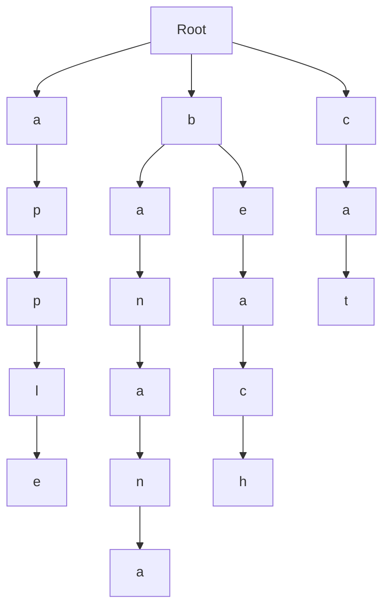

# Trie

If you want to compare many strings, checking them one by one using brute force is slow and wastes a lot of computational effort.

```cpp
"cat" != "apple"
"cat" != "banana"
"cat" != "beach"
"cat" == "cat"
```

Instead, we can organize them into a *trie*, which is a tree-based data structure used to compare strings efficently.


